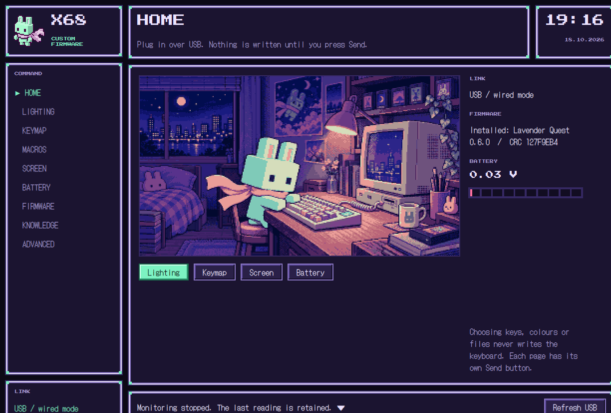
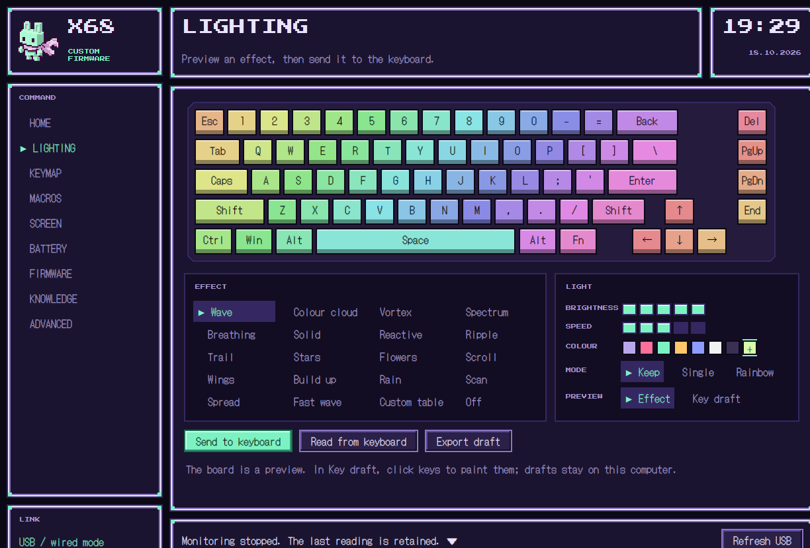
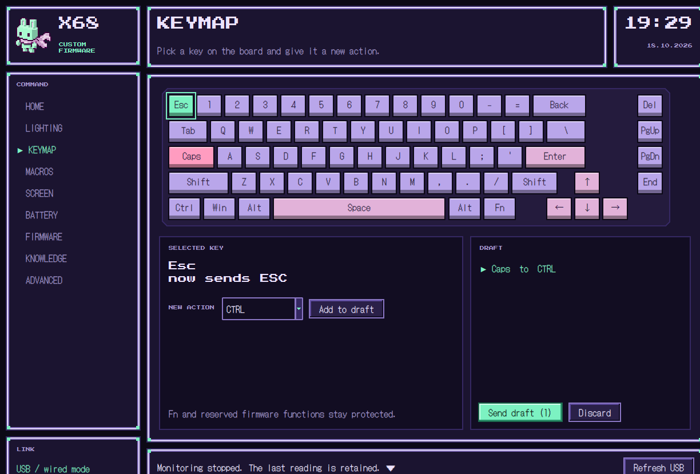
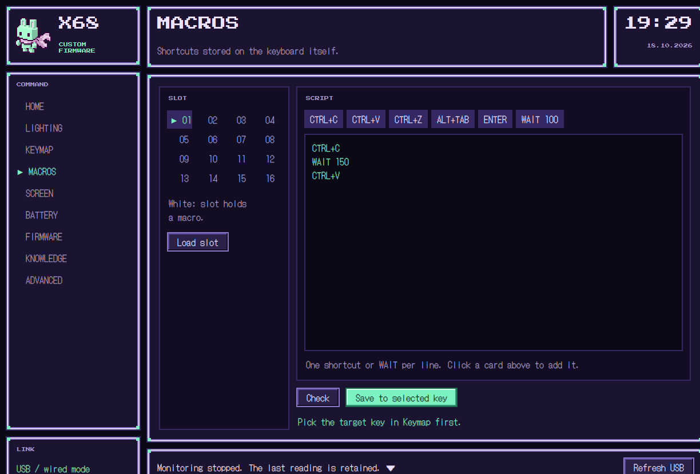
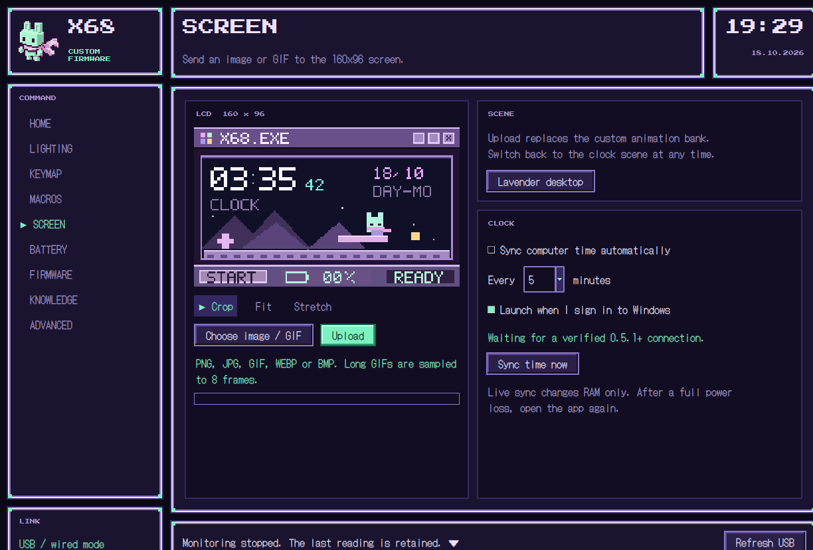
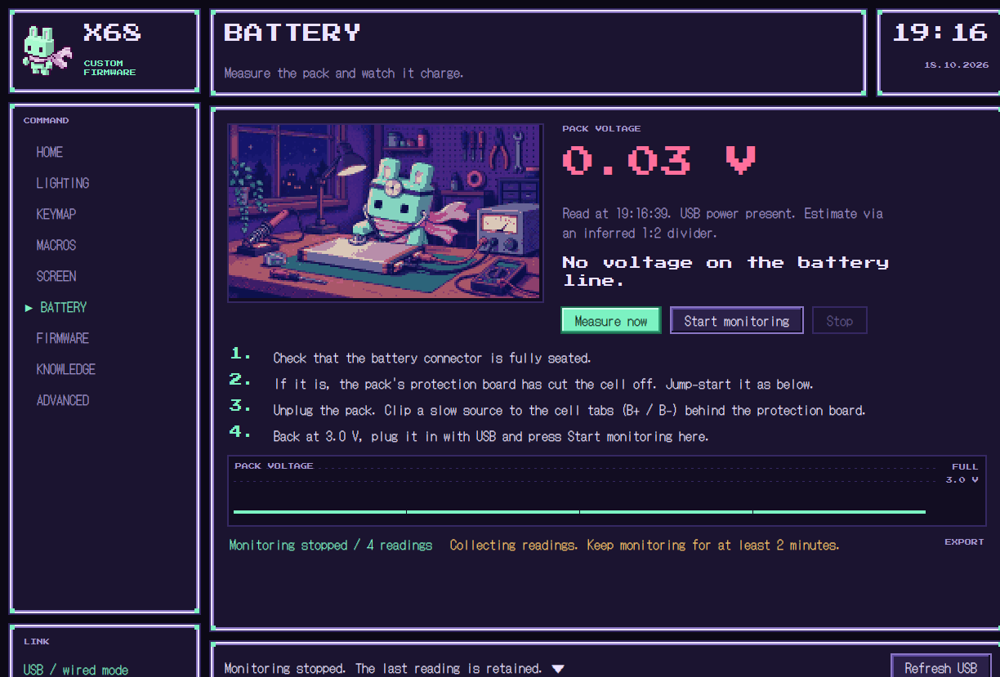

# VGN X68 Custom Firmware

An open-source Windows app for the VGN / SUBOR X68 keyboard. Lighting, keymaps, macros, the little LCD screen, battery checks and firmware, all in one place, with nothing written to the keyboard until you press Send.

<p align="center">
  
</p>



## Why this exists

The X68 ships without a configuration app. VGN's download page lists a single file for it, a firmware updater called `X68-V0113固件升级.exe`. There is no driver or settings tool for lighting, keymaps or macros. When we downloaded that updater, our antivirus flagged it, so we never ran it.

So we built our own. The USB protocol was worked out from scratch, every command is checked against the real keyboard, and the source is here for anyone to read.

## Download and install

**Free and open source. Windows 10 or 11.** Download `VGN-X68-Custom-Firmware-<version>-Windows.exe` from [GitHub Releases](https://github.com/fatihacan1/vgn-x68-custom-firmware/releases/latest) and run it. It is a single portable EXE. You do not need to install anything, including Python.

The EXE is **not code-signed**, so Windows SmartScreen may warn on first launch. Choose **More info → Run anyway**, and only do this for a file you downloaded from this repository. Each release includes `SHA256SUMS.txt`. Check your download in PowerShell:

```powershell
Get-FileHash .\VGN-X68-Custom-Firmware-0.9.2-Windows.exe -Algorithm SHA256
```

Plug the keyboard in with a USB cable and set its mode switch to wired. The app finds it on its own.

## What it does

| Page | What you get |
|---|---|
| **Lighting** | 20 effects, brightness and speed, colours. The on-screen board previews the effect before you send it |
| **Keymap** | See saved actions after reopening, click a physical key and choose keyboard actions (F13-F24 included) or media controls (play/pause, previous/next track, mute, volume). Collect changes in a draft and send them in one go. Selecting a macro key loads its saved slot. Fn and firmware functions stay protected |
| **Macros** | 16 macro slots stored on the keyboard itself. Write `CTRL+C`, `WAIT 100`, `ENTER` and so on, one per line |
| **Screen** | Live Windows/Apple logo, mode badge and open/closed padlock in the title bar (Lavender Quest 0.9.2). Send a PNG, JPG, GIF, WEBP or BMP to the 160×96 LCD, with crop, fit or stretch. GIFs are sampled into 8 frames |
| **Clock** | Choose 24-hour or 12-hour AM/PM display; keeps the keyboard's clock in sync with your computer while the app is open (12-hour mode needs Lavender Quest 0.8.0 and wired USB) |
| **Battery** | Pack voltage from the keyboard's own ADC, a plain verdict, and a charge-trend check while monitoring |
| **Firmware** | Install Lavender Quest (custom LCD desktop) or roll back to VGN's original V0113 |
| **Knowledge** | Everything we verified about the X68, ready to copy into an AI chat or export |
| **Advanced** | Raw packets, settings backups and restore, and a key tester |

## How it stays safe

- **Nothing is written until you press Send.** Picking keys, colours, effects or files only changes the preview.
- **Every write is backed up and read back.** Lighting, keymap and macro writes save a JSON backup first, then the app reads the keyboard again and compares. Any backup can be restored from Advanced.
- **The keyboard is identified exactly.** Vendor and product IDs, names, interface and the full HID report descriptor must all match before a single command is sent. Similar keyboards are refused.
- **No blind retries.** If a packet is short or a reply is missing, the app stops and tells you. It does not resend.
- **Unknown firmware needs an explicit opt-in.** Size, header and CRC checks are not treated as proof that a file is safe.

## Firmware

Lavender Quest replaces the stock LCD desktop with a purple pixel scene, adds the live clock sync and the image/GIF player, and (in 0.6.0) the battery readout used by the Battery page. Charging logic is not touched.

**This repository and the EXE contain no VGN code.** The custom builds ship as patches holding only the bytes this project wrote. On first install the app downloads VGN's official updater from VGN's own server, reads it as bytes (it is never saved or run), finds the V0113 firmware inside by its SHA256, and applies the patch on your computer. The result must match the reviewed build's SHA256 exactly or nothing is installed. Offline? Use **Import file** with a copy of the official updater or the raw `.bin`.

After an install the app checks the CRC the keyboard reports. That confirms the right image landed, but it is not a full read-back of the flash. Keep the cable in until it finishes. An interrupted firmware update is a real risk on any device.

## Battery

The Battery page reads the pack voltage straight from the keyboard's ADC (Lavender Quest 0.6.0) and tells you what it means. Press **Start monitoring** with USB connected: a rising voltage means the keyboard is charging, a flat line means it is not.

While building this we mapped every pin the firmware drives. The X68's charger chip works on its own, and the MCU only reads its status. Software cannot switch charging on or off. If your keyboard will not charge, the cause is in the hardware. [The full investigation](docs/BATTERY-INVESTIGATION.md) (in Turkish) has the pin map and the measurements to take.

## Testing

- **111 automated tests**: packet encoding and checksums, settings and keymap decoding, saved key assignments after reopening, media action encoding and reassignment, the macro compiler, image conversion, firmware OTA framing, patch rebuilds against the reviewed hashes, battery maths and UI regressions. Run them with `npm test`.
- **Emulated before flashed.** The custom LCD renderer is compiled for RV32 and run in an emulator against the real firmware image before any build is allowed onto a keyboard.
- **Checked on real hardware.** Lighting, keymap and macro writes with readback, firmware installs with CRC checks, clock sync and battery reads were all run on a real X68. Custom GIF playback on the physical LCD is still waiting for confirmation.

## Screenshots

| Lighting | Keymap |
|---|---|
|  |  |

| Macros | Screen |
|---|---|
|  |  |



## Build and run from source

Requires Windows 10 or 11, Python 3.10 or later with Tk, and Node.js (only as a launcher; there are no npm packages).

```bash
npm run dev
```

| Command | What it does |
|---|---|
| `npm run dev` | Creates `.venv`, installs `hidapi` and `Pillow`, opens the app |
| `npm test` | Runs the test suite |
| `npm run check` | Prepares the environment without opening the app |
| `npm run build:windows` | Runs the tests, then builds the single EXE and `SHA256SUMS.txt` into `dist/` (needs PyInstaller in `.venv`) |
| `python app.py --verify-library` | Rebuilds every firmware from the official payload and prints the hashes. No keyboard needed |

macOS can run the app from source, but USB communication has not been tested on a Mac.

For macOS packaging, run `npm run build:macos` with PyInstaller and the runtime dependencies installed in `.venv-macos`.
For release builds, set `X68_CODESIGN_IDENTITY` to your Developer ID Application identity and reuse the same identity across updates.
Without it, the bundle receives an ad-hoc signature tied to its contents, so updating the app can invalidate its Input Monitoring permission.
Signing does not notarize the app or grant Input Monitoring automatically.

## Project layout

```
app.py                 entry point and command-line tools
x68/                   USB protocol, settings, macros, media, battery, firmware, UI
firmware/              source of the custom LCD renderer (C, RV32)
firmware-patches/      Lavender Quest builds as patches (only bytes this project wrote)
tools/                 renderer build and emulation, patch maker, firmware pin mapper
tests/                 unit and UI regression tests
docs/                  protocol notes, verified knowledge, battery investigation
assets/                pixel art, fonts, icon
```

## Disclaimer

This is an independent hobby project. It is not affiliated with, endorsed by or connected to VGN or SUBOR. Writing settings and firmware to a keyboard carries risk, and you use this software at your own risk.

## Credits

Fonts: [DotGothic16](https://fonts.google.com/specimen/DotGothic16) and [Press Start 2P](https://fonts.google.com/specimen/Press+Start+2P), both under the SIL Open Font License (`assets/fonts`).

## License

[MIT](LICENSE)
